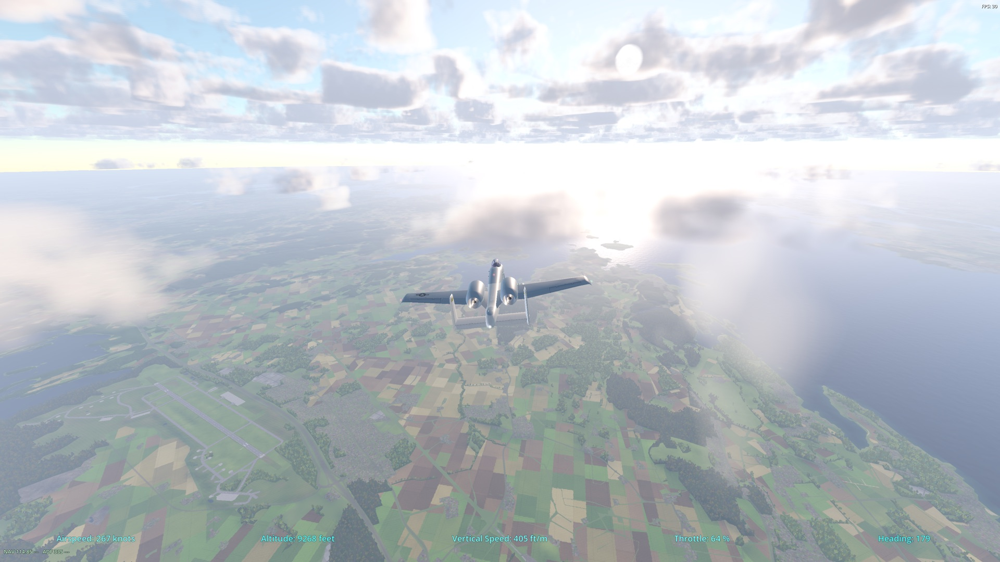
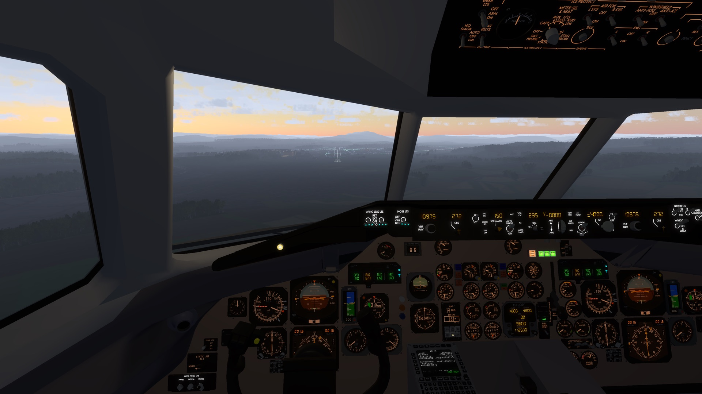
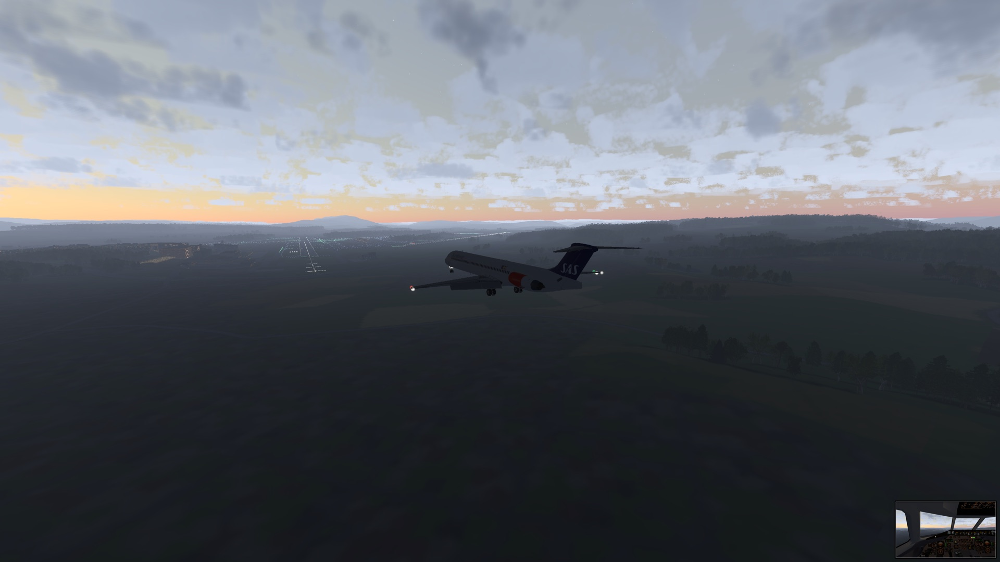
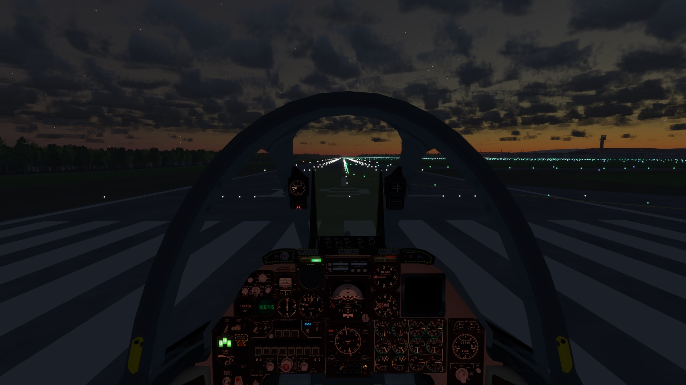

# ProVPilot

A free, open-source flight simulator for visual and instrument flying over
Europe, built on [JSBSim](https://github.com/JSBSim-Team/jsbsim) flight dynamics
and a double-precision build of the [Godot](https://godotengine.org/) engine.

Homepage and downloads (macOS, Windows): **https://www.md80.ch/provpilot/**



| | | |
|---|---|---|
|  |  |  |
| MD-80 cockpit, ILS approach | MD-80 on final at dusk | A-10, runway lights at night |

ProVPilot started as a Cessna over Swiss terrain. It now draws the whole
globe, streams base scenery for nine European countries, and flies a small
fleet from a glider to an airliner with working cockpits.

## What is in it

### Aircraft

| Aircraft | Notes |
|---|---|
| Cessna 172P | piston trainer; VOR / ILS / ADF gauges, KX 165 and KR 87 radios |
| Pilatus PC-7 | turboprop trainer with the same instrument set |
| Fairchild A-10 | FlightGear port at real size: clickable cockpit, HUD, electrical system — [docs/A10_FLIGHTGEAR_PORT.md](docs/A10_FLIGHTGEAR_PORT.md) |
| McDonnell Douglas MD-81 / 82 / 83 / 87 | FlightGear port: the full systems model (electrical, fuel, hydraulics, pneumatics, APU), a virtual cockpit with 399 clickable parts, DFGS autoflight with autothrottle, ILS and autoland, airline liveries — [docs/MD80_FLIGHTGEAR_PORT.md](docs/MD80_FLIGHTGEAR_PORT.md) |
| Schleicher ASK 21 | glider (airborne start until winch and aerotow exist) — [docs/ASK21_PORT.md](docs/ASK21_PORT.md) |
| Car, Re 4/4 locomotive | ground vehicles; the car drives on the drawn roads — [docs/VEHICLES.md](docs/VEHICLES.md) |

Every airframe is described by a plain-text `aircraft.cfg` (model, JSBSim
wiring, animations, gear, cameras, lights, sounds), so the engine stays
aircraft-agnostic: [docs/AIRCRAFT_CONFIG.md](docs/AIRCRAFT_CONFIG.md). FlightGear
aircraft keep their own animation, instrument, sound and property files; a
property mirror and a small set of Nasal shims run them
([docs/INSTRUMENTS.md](docs/INSTRUMENTS.md)).

### World

- **Globe**: the whole Earth in ECEF coordinates from the
  [world3d](https://github.com/Q-coder/world3d) extension (ETOPO elevation);
  local scenery replaces it where tiles are installed — [docs/WORLD3D.md](docs/WORLD3D.md)
- **Base scenery** for Norway, Sweden, Finland, Denmark, Germany, Switzerland,
  Austria, Italy and France: 30 m terrain (SRTM) streamed by the
  [Scenery3D](https://github.com/Q-coder/scenery3d) extension with
  distance-based level of detail and far terrain chunks out to 200 km; one
  download per country from Settings > Downloads —
  [docs/WORLD_SCENERY_DESIGN.md](docs/WORLD_SCENERY_DESIGN.md),
  [docs/SCENERY_DISTRIBUTION.md](docs/SCENERY_DISTRIBUTION.md)
- **Airports**: runways with markings, taxiways, aprons and night lighting
  from OurAirports and OpenStreetMap, on plateaus baked into the terrain
- **The sea**: the OpenStreetMap coastline cut into the terrain, one water
  surface with reflection, ripples and a soft shore; aircraft can ditch and
  sink — [docs/SEA.md](docs/SEA.md)
- **Forests** as species cards (beech, oak, maple, birch, spruce, fir, pine)
  near the aircraft and painted land cover to the horizon; **roads** baked
  with embankments and bridges ([docs/ROAD_NETWORK_PLAN.md](docs/ROAD_NETWORK_PLAN.md));
  **city lights** at night ([docs/CITY_LIGHTS.md](docs/CITY_LIGHTS.md))
- **Sky and weather**: sun by date and time, atmospheric sky, cloud layers,
  haze and fog; live weather from METAR reports or a manual setting
- **Detail add-ons** (optional): 1 m terrain, orthophotos, 3D buildings, roads
  and water for Switzerland (swisstopo) and Baden-Württemberg (LGL); custom
  object packs per airport — [docs/SCENERY_ARCHITECTURE.md](docs/SCENERY_ARCHITECTURE.md),
  [docs/SCENERY_LIBRARY.md](docs/SCENERY_LIBRARY.md)

### Flying

- **Radio navigation**: VOR, DME, NDB and ILS receivers over 901 navaids and
  ILS at 292 airports, magnetic headings from the WMM2025 model —
  [docs/RADIO_NAVIGATION.md](docs/RADIO_NAVIGATION.md)
- **VFR map**: a movable, resizable heading-up map with hillshaded terrain,
  the sea, airports, navaids, ILS feathers and range rings (N) —
  [docs/VFR_MAP.md](docs/VFR_MAP.md)
- **Cockpits**: click, drag or wheel every switch and knob; cockpit, orbit
  and chase cameras; a readout HUD
- **Crash detection** (hard touchdown, overstress, overspeed, water) with
  realism settings — [docs/CRASH_DETECTION.md](docs/CRASH_DETECTION.md);
  **pause** on P; a **logbook** with totals and a flight recorder profile per
  flight — [docs/LOGBOOK.md](docs/LOGBOOK.md)
- **Effects**: exterior lights, exhaust heat haze, engine and FlightGear
  sound sets — [docs/AIRCRAFT_EFFECTS.md](docs/AIRCRAFT_EFFECTS.md)
- **Slew mode** (Shift+Y) to reposition, an intro zoom from space that doubles
  as the loading view, start on any runway or airborne
- **Joystick and keyboard**: every pad axis and button and every key is
  bound in Settings (Joystick, Keyboard), with calibration, deadzone and
  response curves
- **Scenery editor** (F8, or Edit Mode on the welcome screen): place roads,
  railways, structures and objects on the terrain —
  [docs/SCENERY_EDITOR.md](docs/SCENERY_EDITOR.md)

## Getting started

1. Download the application from https://www.md80.ch/provpilot/ and put it in
   a folder of its own. The install is portable: settings (`provpilot.cfg`),
   aircraft data and scenery live next to the application and move with it.
2. Start it, open **Settings > Downloads** and install the base scenery of
   the countries you fly in (0.4 GB for Switzerland to 4 GB for France).
3. Pick an aircraft, an airport and a runway on the welcome screen and click
   **Fly!**. Escape returns to the welcome screen.

Settings tabs: Aircraft (start, livery), Scenery (library with priorities),
Downloads, Graphics, World (time), Weather, Map, Sound, Realism, Joystick,
Keyboard, Logbook.

## Controls

Every key below is a default. **Settings → Keyboard** shows the mapping in
three sections (Flight, Slew, Scenery editor), lets you rebind each action to
up to two keys (click the key, press the new one; Escape keeps it, Backspace
clears it; Shift / Ctrl / Alt alone bind on release), marks a key used twice in
the same section, and **Save** writes `keyboard.cfg` next to `provpilot.cfg`
(a plain config file: `[flight] flaps_down="F"`, `[slew] slew_up="Q, PageUp"`;
`Ctrl` also means Cmd). The in-game hints follow the mapping.

### Flight Controls
| Control | Gamepad | Keyboard |
|---------|---------|----------|
| Pitch (Elevator) | Left Stick Y | W / S |
| Roll (Aileron) | Left Stick X | A / D |
| Rudder | Right Stick X | Y (left) / X (right) |
| Throttle Up / Down (fine) | Right / Left Trigger | U / O |
| Throttle Up / Down (step) | — | T / Shift+T |
| Flaps Down / Up | LB / RB (left / right shoulder) | F / Shift+F |
| Mixture Richer / Leaner | — | M / Shift+M |
| Magneto Clockwise / Counter-CW | — | I / Shift+I |
| Landing gear | — | G |
| Speed brakes | — | B |
| Reverse thrust on / off (MD-80: on the ground with the levers at idle; the throttle then commands reverse power, the same key stows the buckets) | — (bindable: Reverse thrust) | R |
| Wheel brakes on / off (parking brake set at every flight start) | A Button | . / , |
| Nose-wheel steering range (A-10) | — | Ctrl+W |
| Landing / taxi lights | — | L |
| Start / stop the flight model | — | Shift+R / E |
| Pause / resume | — | P |
| Trim Up / Down (hold) | Y / X Button | — |
| Slew Mode | — (bindable: Slew toggle) | Shift+Y |
| Scenery editor (design / developer mode, docs/SCENERY_EDITOR.md) | — | F8; inside: WASD, E/Q or PgUp/PgDn, 1–9 tools, 0 pick a baked road, O objects, C curved, [ ] heights, Space top view, axis gizmo, Ctrl+S, Ctrl+B bake the tiles around; no haze while editing — tutorial in the doc |
| VFR Map Toggle | — | N |
| Move the VFR map frame / resize it | — | drag its title bar / drag its bottom-left or bottom-right corner (remembered in provpilot.cfg) |
| VFR Map Zoom | Wheel over map frame | − / + (=) |
| Weather overlay / FPS counter | — | Ctrl+I / Ctrl+Shift+F |
| Fullscreen / windowed (also sets Graphics > Fullscreen) | — | Alt+Enter |
| Flap Lever Drag | — | Mouse drag (cockpit) |
| Skip the intro flight | — | Space |
| Return to Welcome | — | Escape |

### Camera Controls
| Control | Gamepad | Keyboard |
|---------|---------|----------|
| Switch Camera (Cockpit/Orbit/Chase) | B Button | C |
| Switch Camera the other way (Cockpit/Chase/Orbit) | — | Shift+C |
| Pan the view (cockpit head, orbit, chase) | — | hold the right mouse button + mouse |
| Head Look (Cockpit) | D-pad (or the Camera: Look X / Y axes) | Arrow Keys |
| Orbit/Chase Camera Adjust | D-pad (or the Camera: Look X / Y axes) | Arrow Keys |
| Zoom In (orbit/chase distance; cockpit field of view) | — (bindable: Camera: Zoom in) | Page Up |
| Zoom Out | — (bindable: Camera: Zoom out) | Page Down |
| Look around (cockpit) | — | hold Space + mouse |
| Zoom cockpit view | — | hold Space + mouse wheel |
| Move the eye point (cockpit): left / right / up / down | — | Ctrl + Arrow Keys |
| Move the eye point forward / back | — | Ctrl+Shift + Up / Down |
| Eye point back to the aircraft's default | — | Ctrl+Space |
| Cockpit knobs (Kollsman, OBS course, radio frequencies, ADF card…) | — | click zones, or mouse wheel over the knob (Shift = coarse); see docs/RADIO_NAVIGATION.md |
| Show every cockpit mouse-sense area | — | Ctrl+Shift+H |
| Recentre cockpit view (head + zoom) | — | Space (tap) |
| HUD overlay: off / readouts / readouts + coordinates | — | H |

### Vehicles (ground)
The welcome screen has a **Vehicles** frame under the aircraft: a low-poly car
and an SBB Re 4/4 locomotive. Fly! places the selected vehicle on the chosen runway. The car
is driven by a kinematic model on the drawn ground (`src/drive_mode.cpp`, no
physics engine; the baked road ribbons, embankments and bridge decks are part
of that ground, see [docs/VEHICLES.md](docs/VEHICLES.md)): the vehicle keys
are their own section of the keyboard mapping. The locomotive is only placed
for now.

| Control | Keyboard |
|---------|----------|
| Accelerate / brake (brake held at standstill reverses) | W / S |
| Steer left / right | A / D |
| Handbrake | B |
| Cameras | as in flight (C, arrows, Page Up / Down) |

### Slew Mode Controls
| Control | Gamepad | Keyboard |
|---------|---------|----------|
| Move Horizontal | Left Stick | W/A/S/D |
| Move Vertical | Right Stick Y | Q / E (or PgUp / PgDn) |
| Rotate (Yaw) | Right Stick X | — |
| Fast Movement | — | Hold Shift |
| Exit Slew | — | Shift+Y |

> Gamepad axes are calibrated per‑user in **Settings → Joystick**. If your right‑Y is a half‑axis (Logitech Dual Action and similar), bind a different axis to **Slew: Up/Down**, or use the keyboard `Q` / `E` keys for vertical motion. Bindings persist in `provpilot.cfg`.

### Joystick / Gamepad Configuration

Every pad input goes through **Settings → Joystick**: the flight, slew, vehicle and camera-look axes, and the buttons (flaps, trim, brakes, camera, zoom, slew toggle, handbrake, reverse thrust). Nothing is hard-wired to a button or axis number, so a pad that reports its hat or sticks differently (a Logitech F710 in D mode on Windows, for example) is fixed by re-detecting the affected rows. The gamepad never moves the focus in the menus: Godot's built-in pad navigation of the UI is switched off, so **Detect** only sees the stick or button you move.

The defaults are an Xbox layout: left stick roll / pitch, right stick X rudder, triggers throttle, A brakes, B camera, Y / X trim, shoulders flaps, D-pad look. If your `provpilot.cfg` still carries an older layout (trim on the D-pad, camera on Y), **Restore Defaults** on the Joystick tab brings it in line.

For every joystick action:

1. Click **Detect** and move the desired axis (or press the desired button), or pick it by name from the row's list (A / Cross, LB / L1, D-pad up, Left stick X, …). **None** leaves the action unassigned — a pad has fewer buttons than there are actions, so bind the ones you use.
2. The blue bar shows the **raw** axis value; the green bar shows the **calibrated** result that gameplay code receives.
3. With the stick at rest, click **Ctr**. Push to one extreme, click **Min** (or **Max**). The captured raw values define the symmetric `[-1, 1]` mapping — half‑axes work fine, just leave one endpoint equal to center.
4. Tick **Inv** if the direction is reversed. Adjust the deadzone slider so the calibrated bar reads exactly 0 at rest. Pick a response curve (Linear / Squared / Cubed) for analog sensitivity.
5. **Save** persists everything to `provpilot.cfg` (sections `axis.*` / `button.*`). **Restore Defaults** falls back to a generic SDL gamepad layout.

## Building from source

Platforms: macOS on Apple Silicon and Windows. The full guides are
[docs/MACOS_SETUP.md](docs/MACOS_SETUP.md) and
[docs/WINDOWS_SETUP.md](docs/WINDOWS_SETUP.md); the outline:

```bash
git clone --recursive https://github.com/Q-coder/provpilot.git
cd provpilot

# 1. JSBSim (static library)
cmake -S jsbsim -B jsbsim/build -DCMAKE_BUILD_TYPE=Release && cmake --build jsbsim/build --target libJSBSim

# 2. the Godot editor, double precision (submodule godot, branch 4.7-flightsim)
(cd godot && scons platform=macos arch=arm64 target=editor precision=double)

# 3. the extensions: ProVPilot itself and Scenery3D
scons platform=macos arch=arm64 precision=double target=template_debug
(cd provpilot/addons/scenery3d && scons platform=macos arch=arm64 precision=double target=template_debug)

# 4. run
godot/bin/godot.macos.editor.double.arm64 --path provpilot
```

The globe extension is a separate repository,
[world3d](https://github.com/Q-coder/world3d), built the same way next to this
one ([docs/WORLD3D.md](docs/WORLD3D.md)). `scripts/build_macos.sh` and
`scripts/build_windows.ps1` build, export and package a release
([docs/RELEASE.md](docs/RELEASE.md)).

Scenery is not in the repository. Install it with the in-app downloader, or
bake it from the public sources with the tools in `scripts/`
(`scripts/README.md` is the index): `build_world_terrain.py` (SRTM tiles,
runway plateaus), `build_world_sea.py` (coastline), `build_world_forests.py`,
the road bake, `build_map_overview.py` and `bundle_world_pack.py`.

## Repository layout

| Path | Content |
|---|---|
| `src/` | the simulator as a C++ GDExtension: flight model bridge, aircraft rig, FlightGear property / animation / sound / autoflight support, world and scenery, sky, weather, sea, map, radio navigation, UI |
| `provpilot/` | the Godot project: main scene, shaders, bundled aircraft (`aircraft/<id>/`), tests and probes (`tests/`) |
| `provpilot/addons/scenery3d` | Scenery3D terrain streaming (submodule) |
| `godot`, `godot-cpp`, `jsbsim` | engine fork, C++ bindings, flight dynamics (submodules) |
| `scripts/` | scenery bakes, aircraft converters, build and release scripts |
| `docs/` | design and reference documents, linked above |
| `web/` | the homepage |

Only `provpilot/node_3d.gd` (the main scene: it wires the C++ modules and
sequences welcome screen, loading and flight) and a vegetation helper are
GDScript.

## License

ProVPilot is released under the GNU General Public License, version 2
(`LICENSE`). Every third-party component, aircraft and data source with its
licence is listed in [NOTICE.md](NOTICE.md).

ProVPilot is for entertainment and education. It is not certified for flight
training and must not be used for real-world navigation.

## Acknowledgments

- [JSBSim](https://github.com/JSBSim-Team/jsbsim) for the flight dynamics,
  [Godot](https://godotengine.org/) for the engine, and
  [chunky/jsbgodot](https://github.com/chunky/jsbgodot), the Godot 3
  integration this project grew out of
- [FlightGear](https://www.flightgear.org/) and its aircraft authors:
  Octal450 (MD-80 and IT-AUTOFLIGHT); Lee Elliott, Alexis Bory and David
  Bastien (A-10); Heiko Schulz, Thomas Polzer, Viktor Radnai, Benedikt Wolf
  and Gilberto Agostinho (ASK 21)
- Model authors: [KOG_THORNS](https://sketchfab.com/ioai25312)
  ([Cessna172](https://sketchfab.com/3d-models/cessna172-d1b15841c29c43d0862667300bad55a4), CC-BY-4.0),
  [helijah](https://sketchfab.com/helijah)
  ([Pilatus PC-7 Mk I](https://sketchfab.com/3d-models/pilatus-pc-7-mk-i-b13c98ceef134febac09dacc51c005f7), CC-BY-4.0),
  [hotdoghans](https://sketchfab.com/hotdoghans) (Swiss Lok Re 4/4, CC-BY-4.0),
  [Kenney](https://kenney.nl/assets/car-kit) (Car Kit, CC0)
- Data: © [OpenStreetMap](https://www.openstreetmap.org/copyright)
  contributors, NASA SRTM, NOAA ETOPO and WMM, OurAirports, Natural Earth,
  [swisstopo](https://www.swisstopo.admin.ch/), LGL Baden-Württemberg,
  aviationweather.gov
